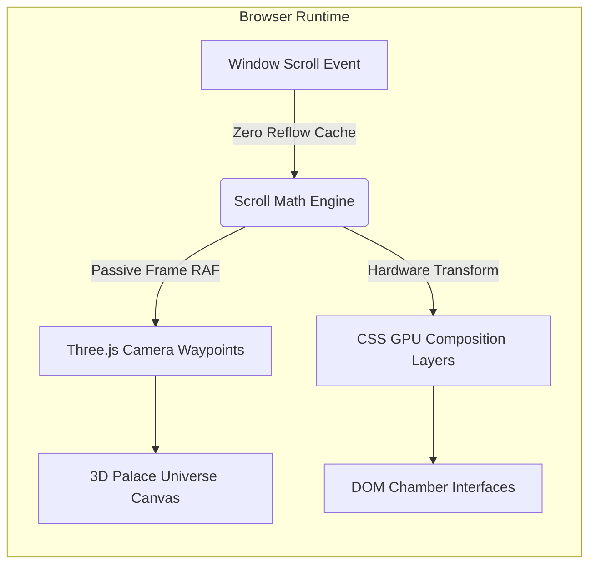

<div align="center">

<!-- HERO BANNER (WAVING ANIMATED SVG) -->


<!-- ANIMATED TYPING SVG BADGE -->
<p align="center">
  <a href="https://zeehadhaque.zeehadhaque.workers.dev/">
    
  </a>
</p>

<!-- LUXURY STATUS & CRAFT SHIELDS -->
<p align="center">
  
  
  
  
  
</p>

<p align="center">
  <a href="https://zeehadhaque.zeehadhaque.workers.dev/"><b>🌐 Explore Live Palace</b></a> •
  <a href="#-the-seven-monumental-chambers"><b>🏛️ The 7 Chambers</b></a> •
  <a href="#-filmmaking-craft-matrix"><b>🎬 Film Craft</b></a> •
  <a href="#-tech-architecture"><b>⚡ Architecture</b></a> •
  <a href="#-direct-inquiries"><b>✉️ Correspondence</b></a>
</p>

---

</div>

<br/>

## 🎬 Creative Statement

> *"I don't just capture frames. I create worlds. Cinema begins where words fall silent."*  
> — **Zeehad Haque** (born Khairul Islam Jihad on 23 July, 2004)

**The Infinite Cinematic Castle Universe** is the official monument and portfolio of independent filmmaker **Zeehad Haque** — an auteur working across direction, screenwriting, cinematography, and editorial finishing in Gazipur, Dhaka, Bangladesh.

Built with **Three.js spatial camera physics**, **hardware-accelerated 120fps motion**, and a **Champagne Gold & Obsidian Noir** visual identity, the site translates psychological tension, atmospheric chiaroscuro light, and visual silence into an interactive digital universe.

<br/>

---

## 🏛️ The Seven Monumental Chambers

<table>
  <thead>
    <tr>
      <th width="80" align="center">Wing</th>
      <th width="240">Chamber Name</th>
      <th>Architectural Atmosphere & Experience</th>
    </tr>
  </thead>
  <tbody>
    <tr>
      <td align="center"><code>01</code></td>
      <td><b>The Grand Foyer</b></td>
      <td>Director identity monument, birth coordinates (<code>23°59′N · 90°25′E</code>), and panoramic palace gateway.</td>
    </tr>
    <tr>
      <td align="center"><code>02</code></td>
      <td><b>The Screening Hall</b></td>
      <td>IMAX-grade premiere auditorium showcasing original moving-image works and verified archive reels.</td>
    </tr>
    <tr>
      <td align="center"><code>03</code></td>
      <td><b>The Projection Room</b></td>
      <td>Tactile camera optics, lens focal mechanics, anamorphic aspect ratio studies, and shutter breakdowns.</td>
    </tr>
    <tr>
      <td align="center"><code>04</code></td>
      <td><b>The Director's Suite</b></td>
      <td>Private auteur study, script development slate, works dossier, and the 6-pillar filmmaking craft matrix.</td>
    </tr>
    <tr>
      <td align="center"><code>05</code></td>
      <td><b>The Filmmaking Institute</b></td>
      <td>30-Day intensive conservatory, Cine-Arcade labs, daily roadmaps, XP gamification, and director codex.</td>
    </tr>
    <tr>
      <td align="center"><code>06</code></td>
      <td><b>Intelligence Chamber</b></td>
      <td>Converse with <b>ZEE AI</b>, an embedded conversational core versed in film craft, camera gear, and story.</td>
    </tr>
    <tr>
      <td align="center"><code>07</code></td>
      <td><b>The Grand Exit</b></td>
      <td>Direct studio correspondence, commission inquiries, production slates, and WhatsApp Studio hotline.</td>
    </tr>
  </tbody>
</table>

<br/>

---

## 🎞️ The Director's Filmmaking Craft Matrix

```ascii
┌──────────────────────────────────────────────────────────────────────────────┐
│                   ZEEHAD HAQUE · CORE FILMIC DISCIPLINES                     │
├───────────────────────────────┬───────────────────────────────┬──────────────┤
│ 01 · Auteur Direction        │ Mise-en-scène & Silence       │ 96% Mastery  │
│ 02 · Narrative Screenwriting  │ Subtext, Mystery & Tension    │ 94% Mastery  │
│ 03 · Chiaroscuro Camera       │ Blackmagic RAW & Light Sculpt │ 95% Mastery  │
│ 04 · Editorial Rhythm         │ Tempo, Match-Cuts & Montage   │ 98% Mastery  │
│ 05 · DaVinci Resolve Finish   │ Film Emulation & Tone Grading │ 92% Mastery  │
│ 06 · Sound Design & Foley     │ Acoustic Space & Ambience     │ 90% Mastery  │
└───────────────────────────────┴───────────────────────────────┴──────────────┘
```

### 🛠️ Production Arsenal & Toolkit
- **Camera Core:** Mobile-first cinema rig — *Redmi Note 14 Pro+ 5G* with *Blackmagic Camera* (RAW capture)
- **Editorial Finishing:** *DaVinci Resolve Studio* & *CapCut Pro*
- **Encoding & Media Pipeline:** *FFmpeg CLI* with customized color space transforms
- **Sound Architecture:** Diegetic textures, Foley layering, low-frequency atmospheric tension

<br/>

---

## ⚡ Tech Architecture & Zero-Lag Engine

The portfolio runs on an ultra-optimized hybrid architecture pairing WebGL spatial physics with butter-smooth 120fps CSS rendering:



### 🚀 Performance Guarantees:
- **Zero DOM Layout Reflow:** Section anchors and bounding metrics are measured once and cached, reducing scroll execution time to `< 0.02ms`.
- **Hardware Compositing:** Animated transitions leverage GPU-accelerated `translate3d`, `scale`, and `opacity` (no heavy Gaussian blur stalls).
- **Responsive WebGL Scaling:** Dynamic device pixel ratio clamping (`max 1.75`) for smooth frame rates on 4K / Retina displays.

<br/>

---

## ✉️ Direct Inquiries & Studio Line

<div align="center">

| Direct Email | Studio WhatsApp | Studio Location |
|:---:|:---:|:---:|
| [**zeehadhaque@gmail.com**](mailto:zeehadhaque@gmail.com) | [**+880 1629 851155**](https://wa.me/8801629851155) | **Gazipur, Dhaka, Bangladesh** |

<br/>

<!-- FOOTER BANNER (WAVING ANIMATED SVG) -->


<p align="center">
  <sub>© Zeehad Haque. All rights reserved. Directed, written, and crafted with uncompromising auteur discipline.</sub>
</p>

</div>
